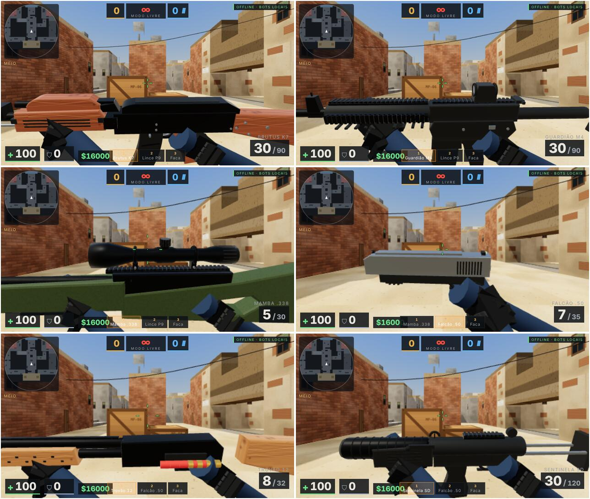

# Mirage Protocol — FPS tático 3D (navegador, PC e celular)

Jogo de tiro tático em primeira pessoa no modo **Desarme de Bomba**, offline contra bots, inspirado na
jogabilidade de FPS competitivos. **Todos os recursos artísticos são gerados por código**: geometria do mapa,
texturas (Canvas 2D), armas e personagens (malhas procedurais), efeitos, interface e **áudio sintetizado**
(Web Audio API). Não há imagens, modelos, sons ou fontes externas.

Única dependência: **Three.js r149** (MIT), já incluída em `lib/three.min.js` — o jogo funciona sem internet.



Capturas reais (Chromium headless, renderização por software) em [`docs/`](docs/): menu, base CT, compra,
combate, bomba plantada, placar, configurações, campo de tiro e controles de toque.

## Armas em alto detalhe

Cada arma é modelada peça a peça em `js/guns.js` (40–150 peças, 1–4 mil triângulos): receptores e coronhas por
perfis extrudados com chanfro, canos/freios de boca/supressores/lunetas torneados, trilhos Picatinny com ranhuras,
miras com pontos de trítio, red dot com retículo, rebites, pinos, alavancas, janela de ejeção, gatilho e guarda-mato,
carregadores curvos com nervuras e cartucho visível, carregador translúcido com munição, cinta de munição na
metralhadora, gravações com nome/calibre, madeira e polímero texturizados e materiais PBR com reflexos de um mapa de
ambiente procedural. No viewmodel as peças estáticas são mescladas por material (poucas chamadas de desenho) e as
móveis (carregador, ferrolho, telha, LED) continuam animadas. Pressione **F** para inspecionar a arma.

## Executar no computador

Opção A — arquivo único (mais simples):
1. Abra `dist/mirage-protocol.html` diretamente no Chrome, Edge, Firefox ou Safari (duplo clique).

Opção B — servidor local (recomendado para desenvolvimento):
```bash
cd fps
python3 -m http.server 8080        # ou: npx http-server -p 8080
```
Abra `http://localhost:8080`.

Para regenerar o arquivo único depois de alterar o código: `node tools/build-single.js`.

## Executar no celular (Android / iPhone)

1. No computador, sirva a pasta na rede local: `python3 -m http.server 8080 --bind 0.0.0.0`.
2. Descubra o IP do computador (ex.: `192.168.0.10`) e abra `http://192.168.0.10:8080` no celular (mesma rede Wi‑Fi).
   Alternativa: publique a pasta `fps/` em qualquer hospedagem estática HTTPS (GitHub Pages, Netlify…) ou copie
   `dist/mirage-protocol.html` para o aparelho.
3. **Android (Chrome):** ao iniciar a partida o jogo pede tela cheia e trava em paisagem automaticamente.
   Também há o botão “TELA CHEIA” no menu.
4. **iPhone (Safari):** o iOS não permite tela cheia de páginas comuns. Use *Compartilhar → Adicionar à Tela de
   Início* e abra pelo ícone (roda sem barras do navegador). Gire o aparelho para a horizontal.
5. Controles de toque (multitoque):
   - polegar esquerdo em qualquer ponto da metade esquerda = analógico de movimento (pouco = andar devagar);
   - arrastar na metade direita = mirar; o botão **FOGO** também mira enquanto arrastado;
   - **MIRA** (luneta/facada forte/arremesso curto), **R**, **PULO**, **AGACH.**, **ANDAR**, **USAR** (plantar/desarmar/pegar arma — brilha verde quando disponível), **TROCAR**, **GRAN.**, **$** compra, **☰** placar, **II** pausa;
   - Configurações → Toque: sensibilidade, tamanho, opacidade, vibração e **reposicionar botões** (arrastar).

## Controles no PC

`WASD` mover · mouse mirar · botão esquerdo atirar · botão direito luneta/alternativo · `R` recarregar ·
`Espaço` pular · `Shift` andar silencioso (configurável para correr) · `Ctrl` ou `C` agachar · `1–5`/roda armas ·
`Q` última arma · `G` granadas · `F` inspecionar arma · `E` plantar/desarmar/pegar · `B` comprar · `Tab` placar ·
`Esc` pausa. (Dica: em alguns navegadores `Ctrl+W` fecha a aba — prefira `C` para agachar.)

## Estrutura

```
fps/
├── index.html            entrada (HTML do HUD e menus)
├── css/style.css         identidade visual e layout responsivo (áreas seguras, paisagem/retrato)
├── lib/three.min.js      Three.js r149 (MIT) — biblioteca, não asset
├── js/
│   ├── core.js           namespace, matemática, eventos, configurações validadas, histórico (localStorage)
│   ├── map.js            planta "Mirage Protocol" em grade, colisão AABB, raycast DDA, A*, zonas, rotas
│   ├── weapons.js        arsenal (atributos reais) e estado de arma (munição, recarga, cadência)
│   ├── world.js          granadas (física com quiques), fumaça, fogo, armas no chão, bomba (máquina de estados), ruídos
│   ├── agent.js          agente (jogador e bots): física, agachar/pular/degraus, disparo, dispersão, recuo, balística, dano
│   ├── bots.js           IA: percepção, memória, audição, estados, combate, cobertura, navegação, granadas, equipe, compras
│   ├── game.js           rodadas, economia, compras, bomba, vitória/derrota, campo de tiro e modo livre
│   ├── selftest.js       autotestes (Node e navegador)
│   ├── textures.js       texturas procedurais
│   ├── render.js         renderizador, céu, luzes/sombras, malha do mapa, detalhes, qualidade
│   ├── guns.js           armas em alto detalhe (perfis extrudados, peças torneadas, PBR + reflexos)
│   ├── models.js         personagens articulados animados e viewmodel (mãos, recarga, inspeção)
│   ├── effects.js        traçantes, impactos, partículas em pool, marcas, fumaça, fogo, explosões
│   ├── audio.js          síntese sonora
│   ├── input.js          teclado/mouse (Pointer Lock) e toque multitoque (Pointer Events)
│   ├── ui.js             HUD, radar, placar, compra, menus, configurações, diagnóstico, resultados
│   └── main.js           inicialização com diagnóstico, laço de passo fixo, câmera, espectador
├── tests/sim-test.js     testes headless (Node): unidades + partidas completas bot x bot
├── tests/browser-test.js testes no Chromium (Playwright): integração e multitoque
├── tools/build-single.js gera dist/mirage-protocol.html
└── dist/mirage-protocol.html  versão em arquivo único
```

## Testes

```bash
node tests/sim-test.js                 # sem navegador; ~3 s
npm i -D playwright && node tests/browser-test.js --shots   # navegador headless + capturas em docs/
```
No jogo: Configurações → Diagnóstico → *Executar autotestes* (fora da partida).

## Limitações conhecidas (honestidade técnica)

- Sem multiplayer online (somente offline contra bots).
- Sem troca de lados no meio da partida; fogo amigo sempre desligado.
- Portas são passagens/arcos (não abrem e fecham); escadas são degraus de 0,4 m.
- Penetração de projéteis implementada apenas em caixas de madeira.
- Animações de personagens são procedurais simplificadas (sem ragdoll); viewmodel com mãos simplificadas.
- Bots não pulam obstáculos e não sobem em caixas (o jogador pode).
- O antisserrilhamento é decidido ao carregar a página; texturas são geradas na qualidade inicial.
- Desempenho medido apenas em renderização por software (CI); 30/60 FPS em hardware real é meta, não garantia.
